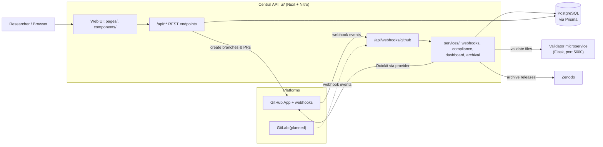
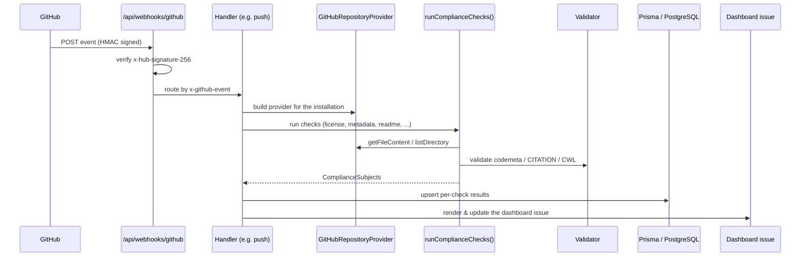
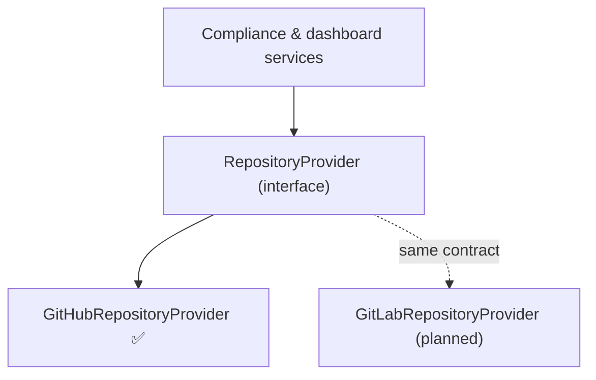
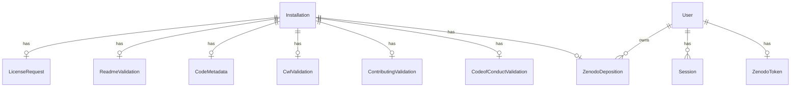

# Architecture

Codefair is a GitHub App that helps research software become FAIR. Behind the
App is a **central API**: a single [Nuxt](https://nuxt.com/) application (the
`ui/` folder) whose server receives GitHub webhooks, runs the FAIR compliance
checks, writes pull requests, and renders the compliance dashboard. A small
[Flask](https://flask.palletsprojects.com/) microservice (the `validator/`
folder) handles file validation.

This page explains how the pieces fit together so you can find your way around
before [running locally](./running-locally.md) or
[contributing a feature](./compliance-check.md).

## The big picture

| Component       | Folder       | Stack                                 | Responsibility                                                                |
| :-------------- | :----------- | :------------------------------------ | :---------------------------------------------------------------------------- |
| **Central API** | `ui/`        | Nuxt 4, Nitro, Octokit, Prisma, Lucia | Web UI **and** backend: webhooks, compliance, dashboard, PRs, archival, auth. |
| **Validator**   | `validator/` | Python 3, Flask, Flask-RESTX          | Validates CWL, `CITATION.cff`, and `codemeta.json` over HTTP.                 |
| **Database**    | n/a          | PostgreSQL                            | Stores installations, per-check state, users, and Zenodo depositions.         |
| **Zenodo**      | n/a          | external                              | Archival of releases and DOI minting.                                         |

## Inside the central API (`ui/server`)

The backend lives in `ui/server` and follows Nuxt/Nitro conventions:

| Path                 | What lives here                                                                                                                  |
| :------------------- | :------------------------------------------------------------------------------------------------------------------------------- |
| `server/api/`        | HTTP endpoints. File name encodes the method, e.g. `index.get.ts`, `index.post.ts`. See the [API reference](./api-reference.md). |
| `server/routes/`     | Non-API server routes: GitHub OAuth login, `add/*` redirect shims, health check.                                                 |
| `server/middleware/` | Runs on every request: session validation and CSRF checks (`auth.ts`).                                                           |
| `server/services/`   | The business logic, grouped by concern (see below).                                                                              |
| `server/utils/`      | Shared helpers: `prisma.ts`, `auth/*`, `cuid.ts`, `logwatch.ts`.                                                                 |
| `server/plugins/`    | Nitro startup plugins, e.g. `env-check.ts` which fails fast on missing env vars.                                                 |

The `services/` folder is where most feature work happens:

- **`services/webhooks/`**: one handler per GitHub event family: `installation.ts`, `push.ts`, `pull-request.ts`, `issues.ts`.
- **`services/compliance/`**: the FAIR checks: `license.ts`, `metadata.ts`, `readme.ts`, `contributing.ts`, `cwl.ts`, orchestrated by `index.ts`.
- **`services/providers/`**: the platform abstraction: `interface.ts` (the contract) and `github.ts` (the GitHub implementation).
- **`services/github-app/`**: `client.ts` wires up the Octokit `App` and hands out installation-scoped clients.
- **`services/dashboard/`**: `manager.ts` (reads/writes the dashboard issue) and `renderer.ts` (pure markdown builder).
- **`services/archival/`**: `interface.ts` (the `ArchivalProvider` contract) and `zenodo.ts` (the Zenodo implementation).

## How a webhook is handled

Every GitHub event flows through the same path. GitHub posts to
`server/api/webhooks/github.post.ts`, which verifies the
`x-hub-signature-256` HMAC against `WEBHOOK_SECRET`, then routes on the
`x-github-event` header to the matching handler.

Key handlers:

- **`installation` / `installation_repositories`**: a repo was added or removed. On add, Codefair creates an `Installation` row, runs the first compliance check, and opens the dashboard issue. (To protect against bulk installs, only the first repositories get a full run; the rest are rate-limited.)
- **`push`**: only the default branch is processed. Codefair re-runs the checks and updates the dashboard.
- **`pull_request`**: tracks the Codefair-created PRs (license, README, …) so the dashboard can show their status.
- **`issues`**: reopening the dashboard issue restores it; closing updates state.

## The provider abstraction (multi-platform support)

The most important design decision is that **compliance services never touch
Octokit directly**. Instead they receive a `RepositoryProvider`
(`server/services/providers/interface.ts`), a platform-agnostic contract with
methods like `getFileContent`, `listDirectory`, `commitFile`,
`createPullRequest`, and `createIssue`.

`GitHubRepositoryProvider` (`providers/github.ts`) implements that contract
today by translating each method into an Octokit request. A future
`GitLabRepositoryProvider` will implement the **same** interface, and the
compliance code will not need to change. This is what makes GitLab support (and
the eventual public REST API) tractable. See
[Platform Providers (GitLab)](./providers.md) for how to add one.

Archival follows the same pattern: `ArchivalProvider`
(`services/archival/interface.ts`) is implemented by Zenodo today, leaving room
for additional archival backends (e.g. Figshare) later.

## Data model

State is stored in PostgreSQL through Prisma (`ui/prisma/schema.prisma`). The
hub of the schema is the **`Installation`** model, one row per repository
Codefair is installed on. Each compliance check has its own model linked 1:1 to
`Installation` and cascades on delete:

Other models include `User` and `Session` (authentication), `ZenodoToken` and
`ZenodoDeposition` (archival), and `Analytics` (usage counters).

## Authentication: two distinct identities

Codefair uses GitHub in two different ways, and it helps to keep them separate:

1. **GitHub App identity**: how Codefair acts _as the bot_ (reading repos,
   committing files, opening PRs and issues). Configured in
   `services/github-app/client.ts` with `GH_APP_ID` and `GH_APP_PRIVATE_KEY`;
   Octokit mints short-lived, installation-scoped tokens automatically.
2. **User identity**: how a human signs in to the web dashboard. This is GitHub
   **OAuth**, handled with [Lucia](https://lucia-auth.com/) sessions and
   [Arctic](https://arctic.js.org/) (`server/utils/auth.ts`,
   `server/middleware/auth.ts`). The user's OAuth token is used to confirm they
   have write access to a repo before any UI-triggered action runs
   (`repoWritePermissions`).

## The validator microservice

The `validator/` service is intentionally small and stateless. It exposes a few
HTTP endpoints (`/validate-cwl`, `/validate-citation`, `/validate-codemeta`,
plus `/up` and `/echo`) and wraps established tools: `cwltool`, `cffconvert`,
and JSON-Schema validation for CodeMeta. The central API calls it via the
`VALIDATOR_URL` environment variable. Because it is decoupled over HTTP, it can
be deployed and scaled independently. To add a new validation type, see
[Adding a Validation Endpoint](./validator.md).

## From Probot to the central API

If you worked on Codefair before, here is what changed:

| Before (Probot, `bot/`)                            | Now (central API, `ui/server/`)                                         |
| :------------------------------------------------- | :---------------------------------------------------------------------- |
| A separate Probot process received webhooks.       | The Nuxt app receives webhooks at `/api/webhooks/github`.               |
| Checks used `context.octokit` directly.            | Checks use a `RepositoryProvider`; Octokit is isolated in one provider. |
| Issue body built by `bot/utils/renderer`.          | Issue body built by `services/dashboard/renderer.ts`.                   |
| Two backends (`bot` + `ui`) with two `.env` files. | One app, one `ui/.env`.                                                 |
| Two deployments to keep in step.                   | One deployment, one Prisma schema.                                      |

Both backends use PostgreSQL through Prisma; that did not change in the
migration. The schema now lives only in `ui/prisma/`.

### The `use_central_api` flag {#use-central-api-flag}

The cutover is per repository, not global. `Installation.use_central_api`
(added in migration `20260320211650`) decides which backend handles a given
repository:

- **`true`**: the central API handles it. Every `bot/` handler early-returns.
- **`false`** (the default): the legacy Probot backend still handles it.

This is why `bot/` is best described as **being retired** rather than gone: it
still serves installations that have not been flipped over. Two consequences
worth knowing:

- The rerun endpoints require `use_central_api` and return **400
  `Central API mode required for rerun`** for repositories still on the legacy
  path.
- `use_central_api` and `license_path` exist only in `ui/prisma/schema.prisma`.
  The `bot/` copy of the schema was never updated.

All new development targets `ui/` and `validator/`. Don't add features to
`bot/`.
