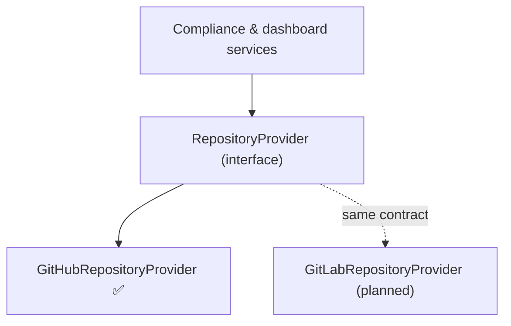

# :electric_plug: Platform Providers (GitLab)

Codefair is being built to work across git platforms, not just GitHub. The mechanism that makes this possible is the **provider abstraction**: every compliance check, dashboard render, and pull-request operation goes through a platform-agnostic interface instead of calling a platform SDK directly.

> [!NOTE] > **Status:** GitLab support is **planned**. The `RepositoryProvider` interface and the GitHub implementation exist today; a `GitLabRepositoryProvider` does not yet. This page documents the contract so the community can help build it.

## :jigsaw: The provider model

The contract lives in `ui/server/services/providers/interface.ts`:

```typescript
/**
 * Platform-agnostic repository provider.
 *
 * All compliance services receive a `RepositoryProvider` instead of a
 * platform-specific SDK (e.g. Octokit). A `GitHubRepositoryProvider`
 * implements this interface today; a future `GitLabRepositoryProvider` will
 * implement the same contract.
 */
export interface RepositoryProvider {
  /* ... */
}
```

Because services such as `runComplianceChecks()` only ever see a `RepositoryProvider`, adding a platform means writing **one new class**. The checks, the dashboard renderer, and the database layer stay exactly the same.



## :clipboard: The contract

`RepositoryProvider` groups its methods into four areas:

| Group        | Methods                                                                                                                                   | Purpose                                                       |
| :----------- | :---------------------------------------------------------------------------------------------------------------------------------------- | :------------------------------------------------------------ |
| **Read**     | `getRepoInfo`, `getLatestCommit`, `getFileContent`, `listDirectory`, `listContributors`, `listLanguages`, `listReleases`, `detectLicense` | Inspect a repository and its files.                           |
| **Write**    | `getBranchSha`, `createBranch`, `commitFile`, `createPullRequest`, `getPullRequest`, `deleteBranch`                                       | Create branches, commit files, and open PRs (merge requests). |
| **Issues**   | `getIssue`, `listIssues`, `createIssue`, `updateIssue`                                                                                    | Manage the FAIR Compliance Dashboard issue.                   |
| **Identity** | `getBotLogin`                                                                                                                             | The bot's login, e.g. `codefair-io[bot]`.                     |

All methods take plain values (`owner`, `repo`, `path`, …) and return the neutral types defined alongside the interface: `RepoInfo`, `FileContent`, `PullRequestRef`, `IssueRef`, and so on. Nothing GitHub-specific leaks through.

## :white_check_mark: The GitHub implementation (reference)

`ui/server/services/providers/github.ts` is the implementation to copy. It wraps an installation-scoped Octokit client and translates each contract method into a GitHub REST call:

```typescript
export class GitHubRepositoryProvider implements RepositoryProvider {
  private octokit: InstallationOctokit;

  constructor(octokit: InstallationOctokit) {
    this.octokit = octokit;
  }

  /** Factory: resolves the installation Octokit then wraps it. */
  static async create(
    installationId: number,
  ): Promise<GitHubRepositoryProvider> {
    const octokit = await getInstallationOctokit(installationId);
    return new GitHubRepositoryProvider(octokit);
  }

  async getFileContent(owner, repo, path, ref?): Promise<FileContent | null> {
    try {
      const { data } = await this.octokit.request(
        'GET /repos/{owner}/{repo}/contents/{path}',
        { owner, repo, path, ...(ref ? { ref } : {}) },
      );
      if (Array.isArray(data) || data.type !== 'file') return null;
      return {
        content: Buffer.from(data.content, 'base64').toString('utf-8'),
        downloadUrl: data.download_url ?? null,
        htmlUrl: data.html_url ?? null,
        path: data.path,
        sha: data.sha,
      };
    } catch (err: any) {
      if (err.status === 404) return null;
      throw err;
    }
  }

  // ...the remaining contract methods
}
```

## :rocket: Adding GitLab step by step

### 1. Implement the provider

Create `ui/server/services/providers/gitlab.ts` with a class that implements `RepositoryProvider`, translating each method to the [GitLab REST API](https://docs.gitlab.com/ee/api/). Map GitLab's vocabulary onto the neutral types. For example, a GitLab **merge request** becomes a `PullRequestRef`:

```typescript
import type {
  FileContent,
  PullRequestRef,
  RepositoryProvider,
  // ...other neutral types
} from './interface';

export class GitLabRepositoryProvider implements RepositoryProvider {
  constructor(private gitlab: GitLabClient) {}

  static async create(projectId: number): Promise<GitLabRepositoryProvider> {
    const client = await getGitLabClient(projectId); // your auth helper
    return new GitLabRepositoryProvider(client);
  }

  async getFileContent(owner, repo, path, ref?): Promise<FileContent | null> {
    // GET /projects/:id/repository/files/:file_path?ref=...
    // Decode base64 content and return the same FileContent shape, or null on 404.
  }

  async createPullRequest(owner, repo, options): Promise<PullRequestRef> {
    // POST /projects/:id/merge_requests
    // Return { htmlUrl, number, state } mapped from the merge request.
  }

  getBotLogin(): string {
    return process.env.GITLAB_BOT_USERNAME ?? 'codefair-bot';
  }

  // ...implement every method on RepositoryProvider
}
```

> [!TIP]
> Let TypeScript guide you: `implements RepositoryProvider` will error until **every** method is present with a matching signature. When it compiles, your provider is contract-complete.

### 2. Add authentication and configuration

GitHub uses a GitHub App with installation tokens. For GitLab you'll add the equivalent: typically a GitLab application (OAuth) or a project/group access token, plus the env vars to configure it (e.g. `GITLAB_APP_ID`, `GITLAB_APP_SECRET`, `GITLAB_BOT_USERNAME`). Mirror `services/github-app/client.ts`, which centralises GitHub auth, with a `services/gitlab-app/client.ts`.

### 3. Receive GitLab webhooks

Add a new route, `ui/server/api/webhooks/gitlab.post.ts`, that mirrors the GitHub one:

- Verify the request using GitLab's `X-Gitlab-Token` header instead of an HMAC signature.
- Read the `X-Gitlab-Event` header and **map GitLab events onto the existing handlers** in `services/webhooks/`. For example, _Push Hook_ → `handlePush`, _Merge Request Hook_ → `handlePullRequest`, _Issue Hook_ → the issues handler.

The handlers themselves don't need to change: they already operate through a `RepositoryProvider`. You construct a `GitLabRepositoryProvider` instead of a `GitHubRepositoryProvider` and pass it in.

### 4. Record the platform on the installation

The `Installation` model currently assumes GitHub. To support multiple platforms you'll need to add a **platform discriminator** (and any platform-specific identifiers) to `prisma/schema.prisma`, for example:

```prisma
model Installation {
  // ...existing fields
  platform   String  @default("github") // "github" | "gitlab"
}
```

> [!IMPORTANT]
> This schema change does not exist yet; it's part of the work to land GitLab. Use a Prisma migration (`yarn prisma:migrate:dev`) so the change is reproducible.

### 5. Select the provider at runtime

Wherever a provider is created today (webhook handlers and the per-repository API routes), branch on the installation's `platform` to build the right one:

```typescript
const provider =
  installation.platform === 'gitlab'
    ? await GitLabRepositoryProvider.create(installation.installation_id)
    : await GitHubRepositoryProvider.create(installation.installation_id);
```

## :package: Archival providers

The same extension pattern applies to **archival**. `ui/server/services/archival/interface.ts` defines an `ArchivalProvider` contract (`validateToken`, `getLoginUrl`, `beginPublication`), implemented by Zenodo today (`archival/zenodo.ts`). A new archival backend such as Figshare would implement the same interface, with no changes needed in the release workflow that consumes it.

## Summary

Adding a platform to Codefair means:

1. Implement `RepositoryProvider` for the platform (`providers/<platform>.ts`).
2. Add the platform's auth/config helper.
3. Add a webhook route that maps the platform's events onto the existing handlers.
4. Add a `platform` discriminator to `Installation`.
5. Construct the right provider based on `platform`.

Everything else (the compliance checks, the dashboard renderer, the database, and the REST API) is already platform-agnostic.
