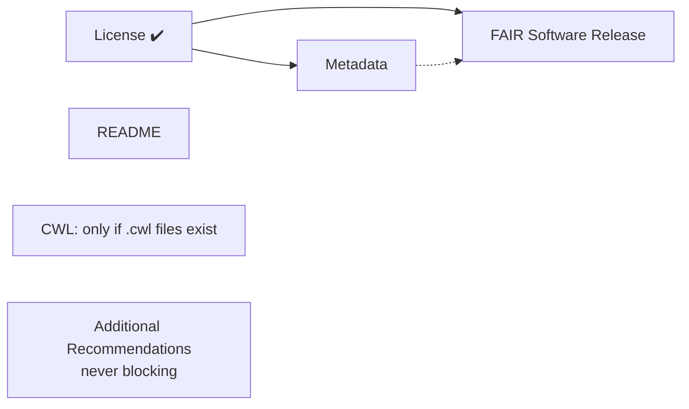

# :mag: How Codefair Assesses FAIRness

Codefair reports on your repository through the **FAIR Compliance Dashboard** (the issue it opens on your repository) and through the Codefair web app. This page explains what each symbol means, what Codefair looks for, and why some checks stay quiet until others pass.

You do not need to read code to follow this page.

## :question: What "FAIR" means here

The [FAIR4RS Principles](https://doi.org/10.1038/s41597-022-01710-x) say research software should be **F**indable, **A**ccessible, **I**nteroperable, and **R**eusable. They describe goals, not a checklist, so Codefair follows the [FAIR-BioRS guidelines](https://doi.org/10.1038/s41597-023-02463-x), which turn those goals into concrete steps: include a license, provide metadata in standard formats, archive each release, and so on.

Codefair checks the steps that can be verified automatically from a repository. It is a helpful assistant, not a certification: passing every check does not by itself make software FAIR, and a ❗ does not mean your work is bad.

## :traffic_light: Reading your results

| Symbol | Meaning                                                                         |
| :----- | :------------------------------------------------------------------------------ |
| ✔️     | The check passed.                                                               |
| ❌     | A required item is missing. There is a button to fix it.                        |
| ❗     | Something exists but needs your attention or confirmation.                      |
| ⚠️     | Codefair could not complete the check, usually a temporary problem on our side. |
| 🟡     | Not checked yet, because a prerequisite is missing.                             |

The ⚠️ state matters and is easy to misread. When a metadata file cannot be validated because Codefair's validation service is unreachable, the result is reported as **"Unknown (Service error, try again)"** rather than invalid. **Your file is not necessarily wrong.** Re-run the check later, and if it persists, [let us know](https://github.com/fairdataihub/codefair-app/issues).

## :white_check_mark: What Codefair checks

### Core checks

These map directly to FAIR-BioRS requirements.

| Check                     | What Codefair looks for                                                                                                                      |
| :------------------------ | :------------------------------------------------------------------------------------------------------------------------------------------- |
| [License](./license.md)   | A license file, identified by GitHub's licensee engine, falling back to `LICENSE`, `LICENSE.md`, `LICENSE.txt`, `COPYING`, `COPYING.LESSER`. |
| [Metadata](./metadata.md) | `codemeta.json` and `CITATION.cff` at the root, each validated against its standard.                                                         |
| [README](./readme.md)     | `README.md`, `README.txt`, or `README`, at the root, in `docs/`, or in `.github/`.                                                           |
| [Archival](./archive.md)  | A DOI for your software, ideally from a Zenodo release made through Codefair.                                                                |

### Language-specific checks

Reported only for projects they apply to.

| Check           | Applies when                                                                         |
| :-------------- | :----------------------------------------------------------------------------------- |
| [CWL](./cwl.md) | Your repository contains at least one `.cwl` file. Each is validated with `cwltool`. |

If no `.cwl` files exist, this section is left off your dashboard entirely; it is not counted as a failure.

### Additional recommendations

| Check                                   | What Codefair looks for                                                              |
| :-------------------------------------- | :----------------------------------------------------------------------------------- |
| [Contributing](./contributing.md)       | `CONTRIBUTING.md`, `.txt`, or extensionless, at the root, in `docs/`, or `.github/`. |
| [Code of Conduct](./code-of-conduct.md) | `CODE_OF_CONDUCT.md`, `.txt`, or extensionless, in the same three locations.         |

These are **not part of the core FAIR compliance checks**. They show ✔️ or ❗ but never ❌, and they never block anything, including releases. Codefair recommends them because they make a project easier to contribute to, which supports reusability.

::: tip
For README, Contributing, and Code of Conduct, Codefair accepts the file at the repository root, inside `docs/`, or inside `.github/`. Any of the three is fine; it takes the first one it finds.
:::

## :lock: Why some checks wait for others

Two sections stay yellow with the note _"Codefair will run this check after a LICENSE file is detected in your repository"_ until you add a license:

- **Metadata**
- **FAIR Software Release** (archival)

This is deliberate rather than a limitation. Both `codemeta.json` and `CITATION.cff` record which license your software is under, and Zenodo requires a license before it will accept a deposit. Generating metadata or archiving a release before that is settled would produce files that need regenerating.

**Add a license first** and the rest of the dashboard opens up.

## :arrows_counterclockwise: When checks run

Codefair re-checks your repository when:

- A repository is first added to Codefair
- You push to your **default branch**
- Codefair opens a pull request for you, or one of its pull requests is closed
- You make a release through Codefair
- You re-run a check yourself from the Codefair dashboard

You can always trigger a fresh check with **Rerun all Codefair checks** from the repository page. Individual checks can be re-run from the menu on each card. See the [UI Dashboard](./ui-dashboard.md) page.

::: warning
If you **close** the dashboard issue, Codefair deactivates for that repository until you reopen it. If you **delete** the issue, you will need to reinstall Codefair on the repository.
:::

## :bulb: What Codefair does not do

- It does not judge the quality of your code, tests, or documentation.
- It does not rewrite your repository behind your back. Changes arrive as pull requests you review and merge, with one exception: publishing a release to Zenodo commits the new DOI into your `CITATION.cff` and `codemeta.json` directly, because the archived version has to contain its own DOI.
- It does not score or rank you, and results are not shared publicly. The only public artifact is the [DOI badge](./archive.md#share-your-doi-badge), if you choose to add one.
